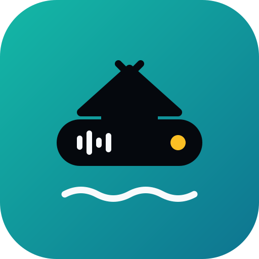

# Lanting



Dynamic Island yang ringan untuk Windows 11. Nama "Lanting" diambil dari rumah rakit terapung khas Banjar: kecil, mengapung di atas, dan selalu ada saat dibutuhkan.

Target: RAM idle di bawah 60 MB, CPU 0% saat diam, animasi spring 60 fps yang dijalankan GPU.

## Status

| Milestone | Isi | Status |
| --- | --- | --- |
| 1. Fondasi | Struktur proyek, window pil, animasi dasar, CI | selesai |
| 2. Media | Spotify / YouTube Music lewat SMTC, kontrol lagu | selesai |
| 3. Animasi polish | Spring, crossfade, visualizer | selesai |
| 4. Lirik | Lirik sinkron dari LRCLIB | selesai |
| 5. Baterai | Notifikasi baterai keyboard & mouse Bluetooth | selesai |
| 6. Rilis pertama | Settings, tray, auto-start, installer | selesai |
| Revisi 1 (v0.2.0) | Menempel di atas, dashboard per menu, tema Windows, halaman Perangkat | selesai |
| Revisi 2 (v0.3.0) | Jadwal sholat, menu ikon, bentuk Notch/Dynamic, wajah berekspresi | selesai |
| Revisi 3 (v0.4.0) | Wajah lebih hidup, tampilan Cuaca/Sholat/Perangkat/Aplikasi dirapikan | selesai |

## Fitur

- **Dua bentuk**: **Notch** yang menempel di tepi atas layar, atau **Dynamic** yang melayang sedikit di bawahnya.
- **Wajah berekspresi** saat tidak ada lagu, bergantian dengan jam (dan versi kecilnya di pojok dashboard): mata bercahaya yang bernapas, berkedip, melirik, mengikuti kursor, sesekali penasaran atau melompat kecil, senang, ngantuk, tidur, cemas saat baterai laptop lemah, merah saat hampir habis, hijau saat penuh. Warnanya mengikuti warna aksen Windows.
- **Dashboard** saat kursor diam sebentar di atas pil. Di atasnya ada menu tombol ikon, dan setiap menu membuka satu halaman:
  - **Musik**: gambar album dengan cahaya warnanya, judul, lirik, tombol sebelumnya / putar / berikutnya.
  - **Cuaca**: cuaca sekarang dengan warna sesuai cuacanya, suhu terasa, kelembapan, angin, dan perkiraan beberapa jam ke depan.
  - **Sholat**: jadwal hari ini (Imsak sampai Isya) dihitung di laptop dengan kriteria Kemenag, waktu berikutnya dengan cincin hitung mundur, dan notifikasi "Waktunya Dzuhur" di island.
  - **Perangkat**: keyboard, mouse, dan perangkat Bluetooth yang tersambung (dongle, Bluetooth, atau kabel) dengan sisa baterainya, plus pengaturan notifikasi baterai. Baterai hanya tampil kalau perangkatnya melaporkan ke Windows; biasanya perangkat Bluetooth bisa, banyak dongle 2.4 GHz tidak.
  - **Aplikasi**: File Explorer, Unduhan, Kalkulator, Notepad, Task Manager, Setelan, dengan ikon asli aplikasinya.
  - Tombol ⚙️ untuk Pengaturan.
- **Mengikuti tema Windows**: terang atau gelap, agak transparan, dengan warna aksen Windows. Bisa diganti ke solid atau hitam pekat di Pengaturan.
- **Lagu yang sedang diputar** (Spotify, YouTube Music, browser, Media Player): gambar album, judul, visualizer.
- **Lirik sinkron** dari LRCLIB, langsung di pil.
- **Baterai Bluetooth**: keyboard/mouse tersambung, terputus, dan baterai lemah.
- **Sembunyi otomatis** saat game, video, atau presentasi layar penuh.
- **Pengaturan** lewat tombol ⚙️ di dashboard, ikon di system tray, atau klik kanan pil.

## Pasang

1. Buka halaman [Releases](https://github.com/HanifAuliya/lanting/releases), lalu unduh `Lanting-Setup-x.y.z.exe`.
2. Jalankan installer. Tidak perlu hak admin.
3. Lanting muncul sebagai pil kecil berisi jam di tengah atas layar, ditambah ikon di system tray.

Kalau Windows SmartScreen memperingatkan ("Windows protected your PC"), klik **More info** lalu **Run anyway**. Peringatan ini muncul karena installernya belum ditandatangani sertifikat berbayar.

Build terbaru (belum dirilis) bisa diunduh dari tab **Actions**: pilih run terbaru, lalu unduh artifact **Lanting-Setup** (installer) atau **Lanting-win-x64** (tanpa install, cukup ekstrak dan jalankan `Lanting.exe`).

## Membuat rilis baru

1. Naikkan `<Version>` di `Directory.Build.props`, commit, lalu merge ke `main`.
2. Buat tag dan push:

   ```powershell
   git switch main
   git pull
   git tag v0.1.0
   git push origin v0.1.0
   ```

3. Workflow **release** otomatis membuat halaman Release berisi installer dan versi portable (zip).

## Build sendiri (VS Code)

Yang perlu dipasang:

1. [.NET 10 SDK](https://dotnet.microsoft.com/download/dotnet/10.0)
2. [Git](https://git-scm.com/download/win)
3. VS Code + extension **C# Dev Kit** (VS Code akan menawarkannya otomatis saat folder ini dibuka)

Lalu:

```powershell
git clone https://github.com/HanifAuliya/lanting.git
cd lanting
dotnet test tests/Lanting.Core.Tests     # tes unit
dotnet run --project src/Lanting.App     # jalankan island
```

Di VS Code: tekan **F5** (konfigurasi "Jalankan Lanting") untuk build + debug. Klik kanan pada pil untuk pengaturan atau keluar.

Visual Studio 2022/2026 dengan workload "WinUI application development" juga bisa: buka `Lanting.sln`.

## Struktur

```
src/
  Lanting.Core/     # logika island tanpa UI: controller prioritas, state machine, kontrak modul, modul media
  Lanting.App/      # WinUI 3: window pil, animasi Composition, DI, sumber SMTC, view per fitur
tests/
  Lanting.Core.Tests/
installer/          # skrip Inno Setup untuk installer
docs/brand/         # logo dan ikon
```

Aturan arsitektur:

- Modul fitur hanya bicara ke `IIslandHost` (Show / Withdraw). Modul tidak pernah menyentuh UI.
- `IslandController` memilih konten yang tampil: prioritas tertinggi menang, bila sama yang terbaru.
- `IslandStateMachine` mengubah kejadian (konten, hover, fullscreen) menjadi state: Hidden, Compact, Expanded, Notification.
- Fitur baru = modul `IIslandModule` di Core + tampilannya `IIslandView` di App, lalu daftarkan keduanya di `App.xaml.cs`. `IslandWindow` tidak perlu diubah.
- Yang butuh API Windows (misalnya SMTC) ada di App di balik interface Core (`IMediaSource`), supaya logika modul tetap bisa dites.
- Tidak ada polling: semua berbasis event. Lirik maju dengan satu timer per baris, bukan pengecekan berkala.

## Privasi

- Untuk mencari lirik, judul dan artis lagu yang sedang diputar dikirim ke [LRCLIB](https://lrclib.net).
- Untuk cuaca dan jadwal sholat, lokasi kira-kira dicari dari alamat internet lewat [ipwho.is](https://ipwho.is) (paling sering 6 jam sekali), kecuali kota dipilih sendiri di Pengaturan. Cuaca diambil dari [Open-Meteo](https://open-meteo.com) paling sering 30 menit sekali, hanya saat halaman Cuaca dibuka. Pencarian kota di Pengaturan memakai geocoding Open-Meteo.
- Jadwal sholat dihitung di laptop, tanpa internet.

Tidak ada data lain yang dikirim. Lirik dan cuaca bisa dimatikan di Pengaturan.

Pengaturan disimpan di `%LOCALAPPDATA%\Lanting\settings.json`, log di `%LOCALAPPDATA%\Lanting\lanting.log`.
