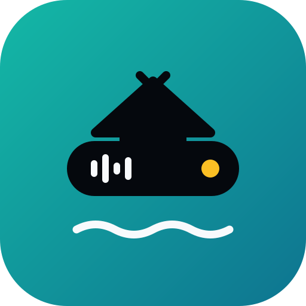

# Lanting



Dynamic Island yang ringan untuk Windows 11. Nama "Lanting" diambil dari rumah rakit terapung khas Banjar: kecil, mengapung di atas, dan selalu ada saat dibutuhkan.

Target: RAM idle di bawah 60 MB, CPU 0% saat diam, animasi spring 60 fps yang dijalankan GPU.

## Status

| Milestone | Isi | Status |
| --- | --- | --- |
| 1. Fondasi | Struktur proyek, window pil, animasi dasar, CI | sedang dikerjakan |
| 2. Media | Spotify / YouTube Music lewat SMTC, kontrol lagu | belum |
| 3. Animasi polish | Spring, crossfade, visualizer | belum |
| 4. Lirik | Lirik sinkron dari LRCLIB | belum |
| 5. Baterai | Notifikasi baterai keyboard & mouse Bluetooth | belum |
| 6. Rilis pertama | Settings, tray, auto-start, installer | belum |

## Coba tanpa build

Setiap push membuat build otomatis di GitHub Actions. Buka tab **Actions**, pilih run terbaru, unduh artifact **Lanting-win-x64**, ekstrak, lalu jalankan `Lanting.exe`.

## Build sendiri (VS Code)

Yang perlu dipasang:

1. [.NET 10 SDK](https://dotnet.microsoft.com/download/dotnet/10.0)
2. [Git](https://git-scm.com/download/win)
3. VS Code + extension **C# Dev Kit** (VS Code akan menawarkannya otomatis saat folder ini dibuka)

Lalu:

```powershell
git clone https://github.com/HanifAuliya/lanting.git
cd lanting
dotnet test tests/Lanting.Core.Tests     # tes unit
dotnet run --project src/Lanting.App     # jalankan island
```

Di VS Code: tekan **F5** (konfigurasi "Jalankan Lanting") untuk build + debug. Klik kanan pada pil untuk keluar.

Visual Studio 2022/2026 dengan workload "WinUI application development" juga bisa: buka `Lanting.sln`.

## Struktur

```
src/
  Lanting.Core/     # logika island tanpa UI: controller prioritas, state machine, kontrak modul
  Lanting.App/      # WinUI 3: window pil, animasi Composition, DI
tests/
  Lanting.Core.Tests/
docs/brand/         # logo dan ikon
```

Aturan arsitektur:

- Modul fitur hanya bicara ke `IIslandHost` (Show / Withdraw). Modul tidak pernah menyentuh UI.
- `IslandController` memilih konten yang tampil: prioritas tertinggi menang, bila sama yang terbaru.
- `IslandStateMachine` mengubah kejadian (konten, hover, fullscreen) menjadi state: Hidden, Compact, Expanded, Notification.
- Fitur baru = implement `IIslandModule` lalu daftarkan di `App.xaml.cs`. Tidak ada file lain yang perlu diubah.
- Tidak ada polling: semua berbasis event.
